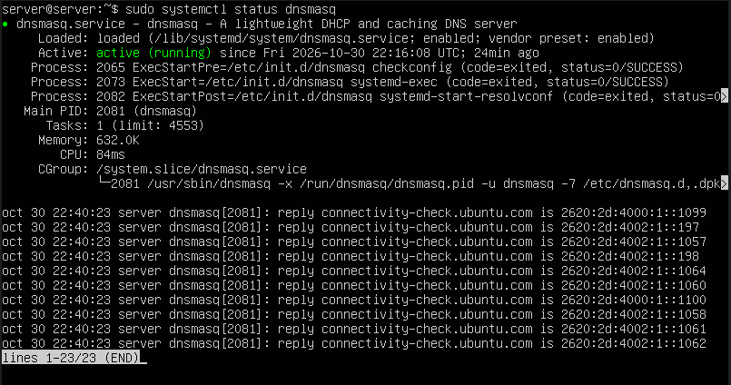
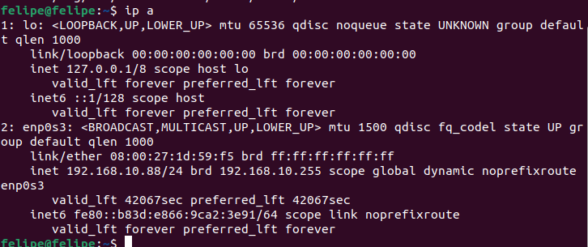
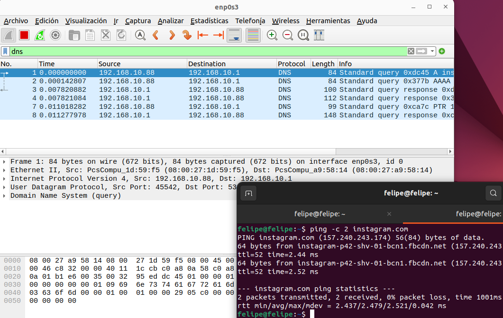
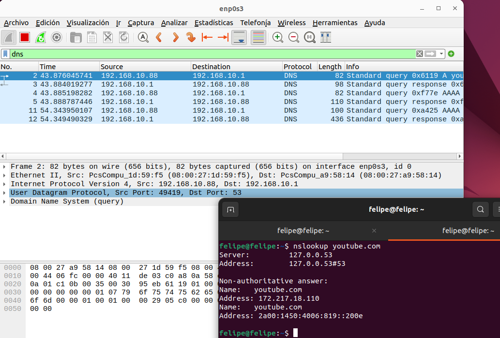
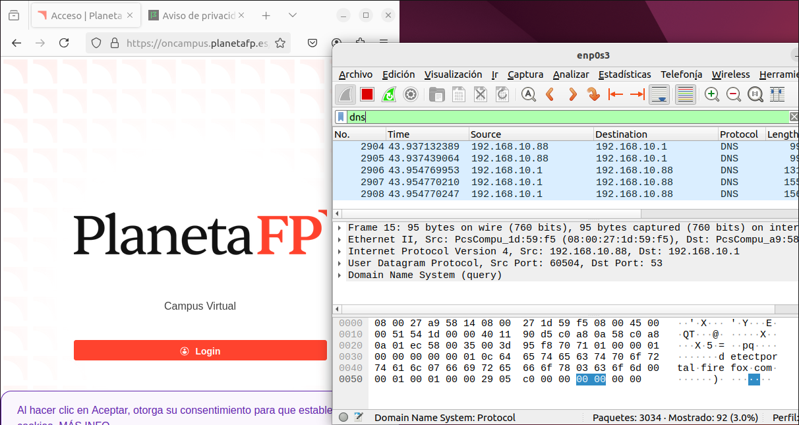
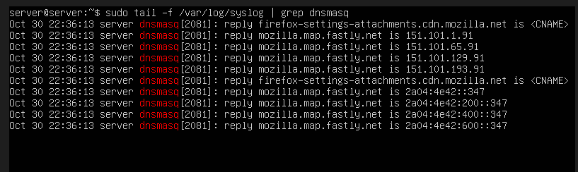
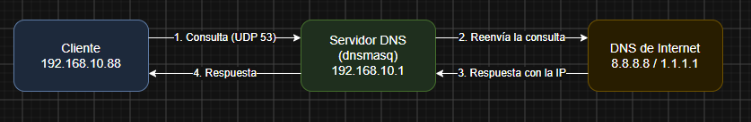
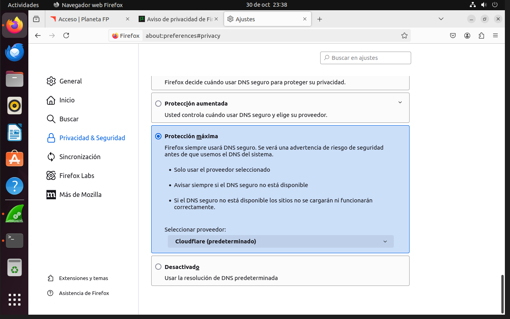
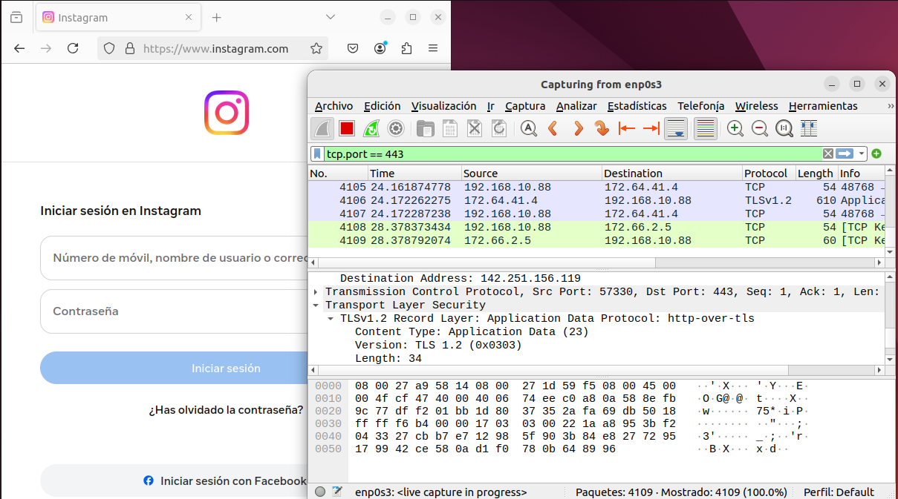

# ACT2 - Seguridad en el DNS (Wireshark)

Módulo 037 Seguridad en servicios (ASIX). Alumno: Felipe

## 1. Objetivo

En esta práctica tengo que ver cómo viaja una petición DNS por la red, analizarla con Wireshark y repetir las pruebas con DNS sobre HTTPS (DoH) para ver qué cambia. El DNS traduce nombres como `youtube.com` a direcciones IP, que es lo que necesita la red para conectarse.

## 2. Escenario

Uso dos máquinas virtuales en VirtualBox:

| MV | Sistema | Red |
|---|---|---|
| Servidor | Ubuntu Server 22.04 | Adaptador 1: NAT (sale a Internet) · Adaptador 2: red interna `intnet` (192.168.10.1/24) |
| Cliente | Ubuntu Desktop 22.04 | Adaptador 1: red interna `intnet` |

El servidor reenvía el tráfico a Internet y hace de DHCP y de DNS con reenviador usando dnsmasq.

## 3. Configuración del servidor

IP fija para la red interna (`/etc/netplan/00-installer-config.yaml`):

```yaml
network:
  version: 2
  ethernets:
    enp0s3:
      dhcp4: true
    enp0s8:
      addresses: [192.168.10.1/24]
```

```bash
sudo netplan apply
```

Reenvío de paquetes y NAT:

```bash
sudo sed -i 's/#net.ipv4.ip_forward=1/net.ipv4.ip_forward=1/' /etc/sysctl.conf
sudo sysctl -p
sudo iptables -t nat -A POSTROUTING -o enp0s3 -j MASQUERADE
sudo apt install iptables-persistent -y
sudo netfilter-persistent save
```

Para el DHCP y el DNS usé dnsmasq. Antes tuve que liberar el puerto 53, porque lo tiene ocupado `systemd-resolved`:

```bash
sudo systemctl disable --now systemd-resolved
sudo rm /etc/resolv.conf
echo "nameserver 8.8.8.8" | sudo tee /etc/resolv.conf
sudo apt install dnsmasq -y
```

Fichero `/etc/dnsmasq.conf`:

```
interface=enp0s8
bind-interfaces
dhcp-range=192.168.10.50,192.168.10.150,12h
dhcp-option=option:router,192.168.10.1
dhcp-option=option:dns-server,192.168.10.1
server=8.8.8.8
server=1.1.1.1
log-queries
```

Al principio no me arrancaba dnsmasq: `systemctl status` decía `bad option at line 8`, por una línea mal puesta en el fichero. Lo arreglé reescribiendo el `dnsmasq.conf` y comprobándolo con `sudo dnsmasq --test` antes de reiniciar. Fue lo que más tiempo me llevó.



## 4. Comprobación en el cliente

El cliente cogió la IP 192.168.10.88 por DHCP del servidor, así que la red interna funciona.



## 5. Peticiones DNS sin cifrar

Wireshark lo instalé en el cliente con `apt`, pero al principio no encontraba el paquete hasta que hice `sudo apt update`. Capturé en la interfaz `enp0s3` con el filtro `dns`.

### 5.1 `ping -c 2 instagram.com`



Salen 6 paquetes DNS: la consulta A (IPv4) y la AAAA (IPv6) con sus dos respuestas, y además una consulta PTR con su respuesta. Esta última la hace el ping para sacar el nombre de la IP, por eso en pantalla aparece `instagram-p42-shv-01-bcn1.fbcdn.net`.

Va por UDP, del cliente (`192.168.10.88`, puerto origen 45542) al servidor (`192.168.10.1`) puerto 53. No hay cifrado: en el detalle del paquete se lee el dominio.

### 5.2 `nslookup youtube.com`



`nslookup` dice `Server: 127.0.0.53`. Es el resolvedor local del cliente (`systemd-resolved`), que reenvía la consulta al DNS que le dio el DHCP, o sea mi dnsmasq (`192.168.10.1`).

En Wireshark salen 4 paquetes: la consulta A con su respuesta y la AAAA con la suya, por UDP del puerto 49419 al 53 y sin cifrar. Las respuestas son `172.217.18.110` (IPv4) y `2a00:1450:4006:819::200e` (IPv6).

### 5.3 Navegador (Firefox)



Al abrir Firefox, antes de cargar la página, salen consultas a `detectportal.firefox.com`. Es el navegador comprobando si hay un portal cautivo. También van por UDP al puerto 53 y, mirando los bytes del paquete (panel de abajo), el nombre se lee en claro. Cualquiera que capture el tráfico de la red puede saber qué webs visitamos.

### 5.4 Lo que ve el servidor

Como puse `log-queries`, dnsmasq apunta en `/var/log/syslog` cada respuesta que da:

```bash
sudo tail -f /var/log/syslog | grep dnsmasq
```



Con esto se ve que las peticiones del cliente pasan por el servidor, que las resuelve y las reenvía a 8.8.8.8 o 1.1.1.1 si no las tiene en caché.

## 6. Camino de una petición DNS

El cliente pregunta a dnsmasq, dnsmasq reenvía la consulta a 8.8.8.8 o 1.1.1.1, y la respuesta vuelve por el mismo camino.



## 7. DNS sobre HTTPS (DoH)

### 7.1 Activación

En el Firefox del cliente: Ajustes, Privacidad y seguridad, y abajo del todo DNS sobre HTTPS. Marqué Protección máxima con Cloudflare de proveedor.



Con Protección máxima Firefox solo usa el proveedor elegido y, si falla, no vuelve al DNS normal.

### 7.2 Repetición de las peticiones

Repetí la petición entrando en `www.instagram.com` desde Firefox. Tiene que ser desde el navegador, porque `ping` y `nslookup` siguen usando el DNS del sistema por el puerto 53 y no pasan por DoH.

Con el filtro `tcp.port == 443` ya se ve el tráfico hacia Cloudflare (172.64.41.4 y 172.66.2.5 en mi captura). Son paquetes TLSv1.2 con `Application Data`: está todo cifrado y en los bytes no se lee ningún dominio.



Con el filtro `dns` las consultas del navegador ya no salen como DNS normal; como mucho sale alguna para localizar al proveedor (`mozilla.cloudflare-dns.com`).

Para ver lo que va dentro hay que descifrar el tráfico con la clave de sesión de Firefox. Se abre el navegador desde la terminal con la variable `SSLKEYLOGFILE`:

```bash
export SSLKEYLOGFILE=~/sslkeys.log
firefox &
```

Luego en Wireshark: Edit, Preferences, Protocols, TLS, y en *(Pre)-Master-Secret log filename* se pone `~/sslkeys.log`. Con el filtro `http2` ya se pueden ver las consultas DNS que van dentro de HTTPS.

### 7.3 Qué cambia

Con el DNS normal las consultas van por UDP 53 y sin cifrar. Con DoH van por HTTPS (TCP 443), cifradas con TLS. Además ya no pasan por mi dnsmasq, van directas a Cloudflare, así que el log del servidor no registra esas peticiones.

La ventaja es la privacidad, porque nadie en la red ve qué dominios consultas. El inconveniente es que el administrador de la red pierde el control y el filtrado del DNS.

## 8. Conclusión

El DNS normal funciona bien pero cualquiera en la red puede ver las consultas. Con DoH van cifradas; vamos, que se gana privacidad pero el DNS de la red se queda ciego.
