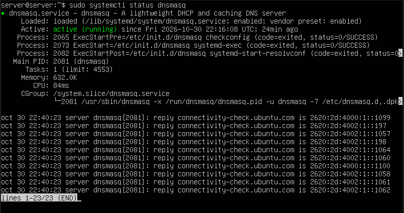
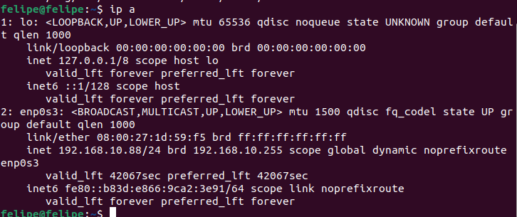
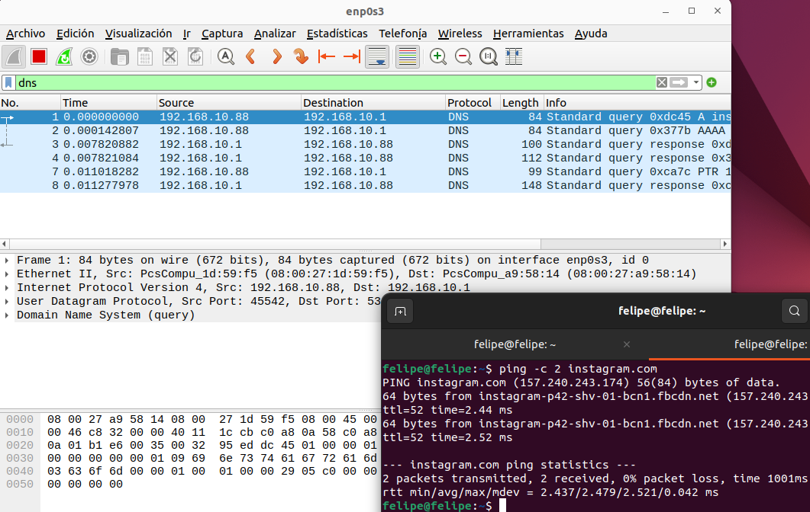
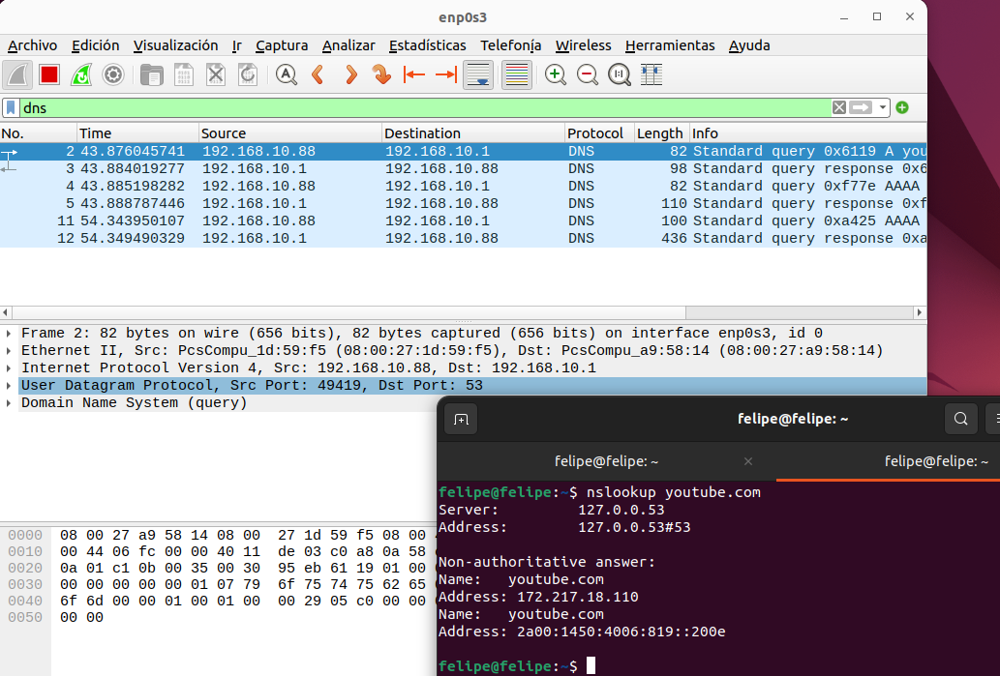
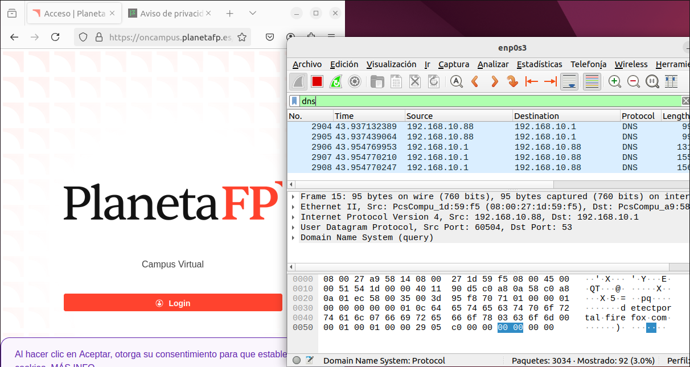
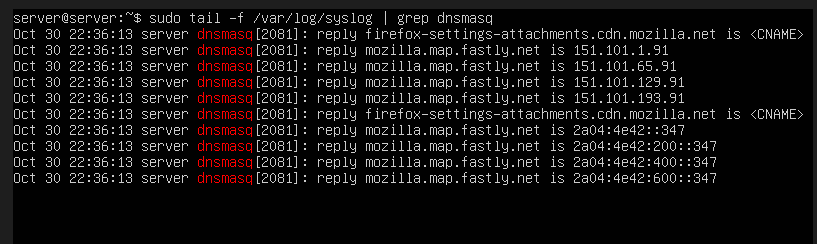
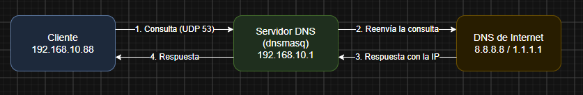
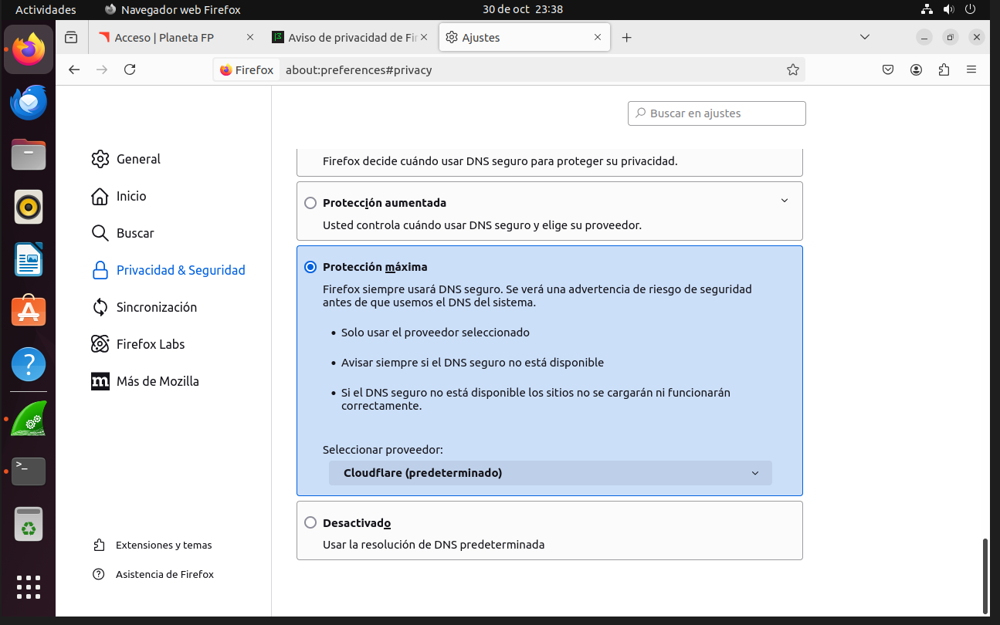

# ACT2 - Seguridad en el DNS (Wireshark)

**Módulo:** 037 Seguridad en servicios · **Ciclo:** ASIX · **Alumno:** Felipe

## 1. Objetivo

Ver cómo viaja una petición DNS por la red, analizarla con Wireshark y comprobar qué cambia al usar DNS sobre HTTPS (DoH).

El DNS traduce nombres como `youtube.com` a direcciones IP, que es lo que realmente necesita la red para conectarse.

## 2. Escenario

Dos máquinas virtuales en VirtualBox:

| MV | Sistema | Red |
|---|---|---|
| Servidor | Ubuntu Server 22.04 | Adaptador 1: NAT (sale a Internet) · Adaptador 2: red interna `intnet` (192.168.10.1/24) |
| Cliente | Ubuntu Desktop 22.04 | Adaptador 1: red interna `intnet` |

El servidor reenvía el tráfico a Internet y da DHCP y DNS (con reenviador) al cliente usando **dnsmasq**.

## 3. Configuración del servidor

**IP fija de la red interna** (`/etc/netplan/00-installer-config.yaml`):

```yaml
network:
  version: 2
  ethernets:
    enp0s3:
      dhcp4: true
    enp0s8:
      addresses: [192.168.10.1/24]
```

```bash
sudo netplan apply
```

**Reenvío de paquetes y NAT:**

```bash
sudo sed -i 's/#net.ipv4.ip_forward=1/net.ipv4.ip_forward=1/' /etc/sysctl.conf
sudo sysctl -p
sudo iptables -t nat -A POSTROUTING -o enp0s3 -j MASQUERADE
sudo apt install iptables-persistent -y
sudo netfilter-persistent save
```

**DHCP y DNS con dnsmasq.** Primero libero el puerto 53, que lo usa `systemd-resolved`:

```bash
sudo systemctl disable --now systemd-resolved
sudo rm /etc/resolv.conf
echo "nameserver 8.8.8.8" | sudo tee /etc/resolv.conf
sudo apt install dnsmasq -y
```

Fichero `/etc/dnsmasq.conf`:

```
interface=enp0s8
bind-interfaces
dhcp-range=192.168.10.50,192.168.10.150,12h
dhcp-option=option:router,192.168.10.1
dhcp-option=option:dns-server,192.168.10.1
server=8.8.8.8
server=1.1.1.1
log-queries
```

Al principio no me arrancaba dnsmasq: `systemctl status` decía `bad option at line 8`, por una línea mal puesta en el fichero. Lo arreglé reescribiendo el `dnsmasq.conf` y comprobándolo con `sudo dnsmasq --test` antes de reiniciar el servicio. Lo que más tiempo me llevó fue dar con ese fallo.



## 4. Comprobación en el cliente

El cliente recibió la IP **192.168.10.88** por DHCP desde el servidor (red interna).



## 5. Peticiones DNS sin cifrar

Wireshark lo instalé en el cliente con `apt`; al principio no me encontraba el paquete hasta que hice un `sudo apt update`. Capturé en la interfaz `enp0s3` con el filtro `dns`.

### 5.1 `ping -c 2 instagram.com`



- Genera **6 paquetes DNS**:
  - 2 consultas: tipo **A** (IPv4) y **AAAA** (IPv6), con sus 2 respuestas.
  - 1 consulta **PTR** con su respuesta: el ping pregunta el nombre de la IP para mostrarlo (por eso sale `instagram-p42-shv-01-bcn1.fbcdn.net`).
- Protocolo **UDP**, del cliente `192.168.10.88` (puerto origen aleatorio, 45542) al servidor `192.168.10.1` **puerto 53**.
- **No está cifrado**: en el detalle del paquete se ve el nombre del dominio en texto.

### 5.2 `nslookup youtube.com`



- El propio `nslookup` indica `Server: 127.0.0.53`: el cliente pregunta primero a su resolvedor local (`systemd-resolved`), que reenvía la consulta al DNS que recibió por DHCP (`192.168.10.1`, nuestro dnsmasq).
- Genera **4 paquetes**: consulta A + respuesta y consulta AAAA + respuesta.
- UDP, puerto origen 49419 → destino 53. Sin cifrar.
- Respuestas: `172.217.18.110` (IPv4) y `2a00:1450:4006:819::200e` (IPv6).

### 5.3 Navegador (Firefox)



Al abrir Firefox, antes de cargar la página, aparecen consultas a `detectportal.firefox.com` (el navegador comprueba si hay un portal cautivo). Son paquetes UDP al puerto 53 y, mirando los bytes del paquete (panel de abajo), se lee el nombre `detectportal.firefox.com` en claro. Cualquiera que capture el tráfico en la red puede saber qué webs visitamos.

### 5.4 Lo que ve el servidor

Como activé `log-queries`, dnsmasq apunta en `/var/log/syslog` cada respuesta que da:

```bash
sudo tail -f /var/log/syslog | grep dnsmasq
```



Esto confirma que las peticiones del cliente pasan por el servidor, que las resuelve (y las reenvía a 8.8.8.8 / 1.1.1.1 si no las tiene en caché) y devuelve la respuesta.

## 6. Camino de una petición DNS



## 7. DNS sobre HTTPS (DoH)

### 7.1 Activación

En el cliente, en **Firefox**: *Ajustes → Privacidad y seguridad → DNS sobre HTTPS* → **Protección máxima**, proveedor **Cloudflare**.



Con "Protección máxima" Firefox solo usa el proveedor elegido y, si no funciona, no carga la web (no vuelve al DNS normal).

### 7.2 Repetición de las peticiones

Con DoH activado hay que repetir las peticiones desde Firefox, porque `ping` y `nslookup` siguen usando el DNS del sistema (UDP 53) y no pasan por DoH.

Lo que se ve en Wireshark:

- Con el filtro `dns` dejan de verse las consultas de las webs que abre el navegador; como mucho puede salir alguna consulta suelta para localizar al proveedor (`mozilla.cloudflare-dns.com`).
- Con el filtro `tls` o `tcp.port == 443` aparece el tráfico cifrado hacia Cloudflare. Solo se ve la IP de destino y paquetes TLS, no qué dominio se está consultando.
- Para ver el contenido hay que descifrar el tráfico con la clave de sesión de Firefox. Se arranca el navegador desde la terminal con la variable `SSLKEYLOGFILE`:

```bash
export SSLKEYLOGFILE=~/sslkeys.log
firefox &
```

  Después, en Wireshark: *Edit → Preferences → Protocols → TLS → (Pre)-Master-Secret log filename* → `~/sslkeys.log`. Con el filtro `http2` ya se pueden ver las consultas DNS que van dentro de HTTPS.

### 7.3 Qué cambia

- El DNS normal va por **UDP 53** y sin cifrar. DoH va dentro de **HTTPS (TCP 443)**, cifrado con TLS.
- Con el filtro `dns` ya no se ven las consultas del navegador; hay que mirar `tls` o `tcp.port == 443`, donde solo se ve que hay tráfico hacia Cloudflare.
- Para ver el contenido hay que descifrar el tráfico en Wireshark con la clave de sesión de Firefox (variable `SSLKEYLOGFILE`).
- Ya no pasa por nuestro dnsmasq: va directo a Cloudflare, así que el log del servidor no registra esas peticiones.

**Ventaja:** más privacidad, nadie en la red ve qué dominios consultas.
**Inconveniente:** el administrador de la red pierde el control y el filtrado del DNS.

## 8. Conclusión

El DNS tradicional funciona bien pero cualquiera en la red puede ver las consultas. Con DoH van cifradas; vamos, que ganas privacidad pero el DNS de la red se queda ciego.
